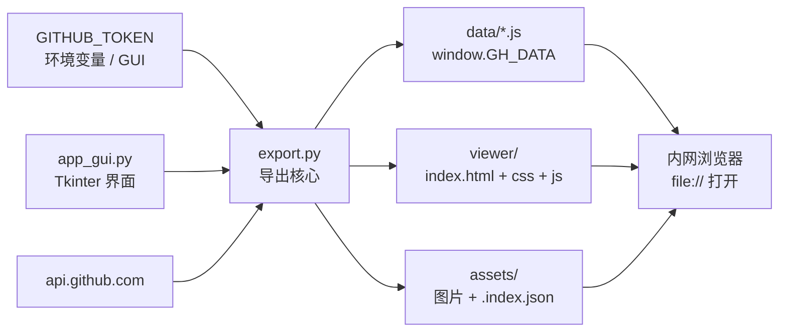

# 项目架构与数据流地图

> 本文档描述当前版本中 Mirror_export 工具的整体架构、导出流水线、增量缓存机制、数据文件格式与查看器渲染边界。
> 任何修改导出逻辑、data 结构或查看器视图前，请先阅读本文档，确保变更不破坏 `export.py` → `data/*.js` → `viewer` 的链路。

## 1. 项目概述

本项目用于在外网把 GitHub 仓库导出为自包含静态站，拷入内网后双击 `index.html` 即可浏览。主要支持：

- 拉取 PR / Issue / Commit / Tag / Release / Branch / 文件树；
- 为 PR、Issue、Commit 拉取详情（diff、评论、文件列表）；
- Release 与上一 Tag 的 compare，并从 release body 关联 `#123` PR；
- 下载 README 等图片资源到本地 `assets/`；
- 下载 PR / Issue / Release 正文与评论中的外链图片到 `assets/externals/`，并写入 `meta.image_map`；
- 增量导出：复用上次缓存，只拉有变化的内容；
- 纯静态查看器：概览 / PR / Issue / Commit / Release / 版本对比 / 文件浏览 / README。

运行角色分离：

| 角色 | 环境 | 入口 |
|------|------|------|
| 外网导出 | 有 GitHub 访问 + Token | `export.py` 或 `app_gui.py` / `dist/Mirror_export.exe` |
| 内网浏览 | 无外网、无写权限 | 导出包内 `index.html` |

## 2. 顶层架构



### 目录结构

```
Mirror_export/
├── AGENTS.md                      项目要求与协作约定
├── ARCHITECTURE.md                架构与数据流说明
├── README.md                      使用说明
├── export.py                      导出核心（CLI + 库）
├── app_gui.py                     图形界面入口
├── viewer/                        查看器模板（导出时复制到输出目录）
│   ├── index.html                 壳页面，按序加载 data/*.js 与 js/*.js
│   ├── css/app.css                GitHub Light 风格样式
│   ├── js/app.js                  路由、列表、详情、diff、文件树
│   └── js/gitgraph.js             分支树泳道布局（纯函数，可 Node 单测）
├── preview/                       本地演示包（无 GitHub 时可打开）
├── sample/                        示例数据（结构同 preview/data）
├── data/                          开发/调试用数据样例
├── assets/                        图标与 README 配图
├── dist/
│   ├── Mirror_export.exe          打包后的 GUI 导出工具
│   └── gh_token_cache.json        本机组合缓存：仓库+输出目录+Token+选项（不进导出包）
└── _inspect_readme.py             辅助检查脚本
```

导出输出目录（可拷入 U 盘）：

```
gh-mirror-<owner>-<name>-<date>/
├── index.html
├── css/app.css
├── js/app.js
├── data/
│   ├── meta.js
│   ├── prs.js
│   ├── issues.js
│   ├── commits.js
│   ├── tags.js
│   ├── releases.js
│   ├── files.js
│   ├── branches.js
│   ├── graph.js
│   └── manifest.json
└── assets/
    ├── .index.json                path/blob sha + ext:<url> → 本地相对路径（增量判断）
    ├── externals/                 PR/Issue/Release 正文外链图片
    └── <repo images...>
```

## 3. 数据流向

主导出链路如下：

```
Token + --repo owner/name + --out 目录
        ↓
export.export(args)
        ↓
1) 可选：load_previous_export / load_asset_index 读取增量缓存
2) GET /repos/{repo}                 → meta
3) tags + releases
4) 每个 release 对上一 tag compare   → compare.commits / files
      · base 按「该 release 的 tag_name 在 tags 列表里的下一个 tag」确定（不是用 release 下标）
      · tags 与 releases 数量/顺序不一致、或存在无 Release 的 tag 时也不会错位/自比
5) commits（本轮窗口 max_commits）
      · 缓存命中则复用
      · 需要时 GET /commits/{sha} 补 diff
      · 历史缓存中不在本轮窗口的 commit 一律保留
6) pulls?state=all&sort=created&direction=desc
      · 列表按编号从新到旧（创建顺序，大号在前）
      · updated_at 未变且已有 files → 整条复用
      · 否则拉 files / commits / comments
7) issues（过滤 pull_request，sort=created&direction=desc）
      · 列表按编号从新到旧
      · updated_at 未变且已有 comments → 复用
      · closed issue 尽量补 closed_by_pr（PR body 或 timeline）
8) git/trees?recursive=1
      · 文本且 size ≤ max_file_bytes 时缓存 contents
      · blob sha 未变则复用正文
9) download_repo_images → assets/（sha 未变则跳过）
10) collect_body_image_urls + resolve_attachment_aliases + download_body_images
      · 扫描 PR/Issue 正文与评论、Release body 中的 Markdown/HTML 图片 URL
      · 私有库 `github.com/user-attachments/assets/*` 直链常 404：经 GraphQL `bodyHTML`
        解析成 `private-user-images.githubusercontent.com/...?jwt=...` 再下载（JWT 约 5 分钟有效，导出时即时拉取）
      · 外链下载到 assets/externals/；树内 raw URL 直接映射已有 assets
      · 写出 meta.image_map：原始 URL → assets 相对路径（键仍是 markdown 里的原始 URL）
11) branches
      · GET /repos/{repo}/branches（--max-branches，默认 100）
      · 每个分支补 head 摘要（能从已导出的 commit 池取到就不发请求）
      · tip 已包含于主干历史 → 0 次 API，本地算 ahead=0 / behind（标注 behind_approx）
      · 否则 1 次 GET /compare/{主干tip_sha}...{分支tip_sha}
        → ahead_by / behind_by / status / merge_base_commit
        → commits[]（slim，含 parents，上限 --max-branch-commits）
        → files[]（聚合差异；--skip-details 时为空）
        → 用 total_commits > 实际返回条数自判 truncated（不硬编码 API 上限）
      · 分支列表是快照：上游删掉的分支本包不再保留（与 commit 的无限累积相反）
12) graph.js（提交池 + 引用表）
      · refs = 分支名/标签名 → sha（来自 branches / tags）
      · nodes = 非主干提交节点（compare 里的独有 commit）+ 悬空占位（stub）
      · 主干已导出的 sha **不重复存**：查看器运行时把 commits.js 与 graph.nodes 合并成一张表
      · 每轮按线上重新派生，**不做跨轮累积**（与 branches 快照语义一致）；
        主干历史仍由 commits.js 无限累积，已合并提交不会丢
13) 分支独有 commit 逐条 diff（--max-branch-diffs，默认 30）
      · 只为真实节点（非 stub）补 diff，按 author_date 新→旧排序，预算优先给最近的提交
      · 上一轮 graph 节点里已有 diff 的按 sha 整块复用，且**不消耗预算**
      · 预算耗尽后剩余节点只保留骨架（图上不断链），不报错
        ↓
copy_viewer + 写出 data/*.js + manifest.json
```

## 4. 入口说明

### 4.1 `export.py`（核心）

```powershell
$env:GITHUB_TOKEN = "ghp_xxx"
python export.py --repo owner/name
python export.py --repo owner/name --out gh-mirror --force
python export.py --repo owner/name --skip-details --no-contents
python export.py --repo owner/name --full   # 强制全量
```

主要 CLI 参数：

| 参数 | 默认 | 含义 |
|------|------|------|
| `--repo` | 必填 | `owner/name` |
| `--out` | `gh-mirror-<repo>-<date>` | 输出目录 |
| `--token` | 环境变量 | 覆盖 `GITHUB_TOKEN` |
| `--incremental` / `--full` | 增量开 | 是否复用上次 `data` 缓存 |
| `--force` | 关 | 允许覆盖非空输出目录 |
| `--max-prs` / `--max-issues` / `--max-tags` | 0=不限（GUI 默认有上限，CLI 默认 0 表示尽量多） | 数量上限。**0 一律表示「不限」**；issues 的上限按「真正的 issue 数」计（边翻页边过滤 PR），不受 PR 占比影响 |
| `--max-branches` | 100 | 最多导出多少个分支；0=全部 |
| `--max-branch-commits` | 100 | 每个分支最多保留多少条「独有提交」；0=全部 |
| `--max-branch-diffs` | 30 | 本轮最多为多少条分支独有 commit 拉逐条 diff；0=不拉；`--skip-details` 时强制为 0 |
| `--no-branches` | 关 | 完全不导出分支数据（`branches.js` 写空数组，查看器自动降级） |
| `--max-commits` | 100 | 每轮从 HEAD 往回爬的 commit 窗口 |
| `--max-commit-diffs` | 同 max-commits | 本轮最多新拉多少条 commit diff |
| `--max-file-bytes` | 400000 | 单文件正文缓存上限 |
| `--skip-details` | 关 | 不拉 diff/评论，更快；分支仍拉 ahead/behind/commits 骨架，仅跳过文件差异 |
| `--no-contents` | 关 | 只保留文件树，不缓存源码 |
| `--no-assets` | 关 | 不下载图片 |

关键函数：

- `http_get`：带 Bearer Token、重试、RateLimit 等待；
- `paginate`：`per_page=100` 翻页，`max_items<=0` 表示尽量拉全；
- `map_pr` / `map_issue` / `map_commit` / `map_file`：把 GitHub API 裁剪成镜像用的精简结构；
- `export()` 内 branches 段：分支清单 + 头部摘要 + 与默认分支对比，含纯落后分支的 0 请求快路径；
- `js_assign` / `parse_data_js`：`data/*.js` 写出与回读（增量合并的基础）；
- `load_previous_export` / `load_asset_index`：读取上次导出包；
- `download_repo_images`：按 blob sha 增量下载图片；
- `progress` / `stage_begin`：同时输出人类可读日志与 `__PROGRESS__{json}` 供 GUI 解析。

**进度协议（`__PROGRESS__`）**

导出的全部进度由 `export.py` 顶部的 `STAGES` 阶段表驱动。每个阶段有一个权重，
`progress()` 据此算出**全局加权百分比 `overall`**（0-100），GUI 直接使用该值驱动
进度条，因此整条进度是连续的，不会再出现「阶段切换时百分比重置 / 倒退」。

机器行字段：

| 字段 | 含义 |
|------|------|
| `stage` / `done` / `total` | 阶段名与阶段内计数（旧字段，含义未变） |
| `note` | 当前条目（文件名 / 图片 URL / PR 标题），GUI 截断显示 |
| `stage_idx` / `stage_n` | 当前阶段序号 / 本轮实际执行的阶段总数 |
| `overall` | 全局加权百分比，GUI 用它设置进度条 |

约定：

- **新增阶段必须在 `STAGES` 中登记**，否则该段进度会缺失（同时更新 AGENTS.md 的既有约定）。
- 为避免「边跑边改分母」导致百分比忽高忽低，分母按**本轮实际会执行的阶段**计算：
  出现在当前阶段之前、但本轮从未出现过的阶段视为跳过（`--no-assets` / `--skip-details`），
  其权重在分子与分母中一并剔除，`stage_idx` / `stage_n` 也按剔除后重新编号。
  `_LAST_OVERALL` 做单调保护，兜底保证百分比只增不减。
- `_SEEN_STAGES` / `_STAGE_DECLARED` / `_LAST_OVERALL` 都是**单轮状态**（模块级全局，
  进程启动时只初始化一次）。GUI 在同一进程内连续导出多个组合，因此 `export()` 开头
  必须调用 `reset_progress()` 清零：否则上一轮遗留的 100% 会被单调保护带进新一轮，
  首帧即显示 100%（切换组合后「进度条一下冲到 100」的已知 bug），跳过阶段的折算也会失效。
- **命中缓存的条目也要计入 `done`**：PR / Issue / Commit / 图片在增量模式下大量复用缓存，
  若只在真正发起网络请求时上报，纯增量导出会出现进度条长时间不动。所有循环的上报点
  都放在 `continue` 之前。
- 高频循环用 `make_throttle(1)` 做**每 1% 一次**的节流，避免刷爆 stdout 与 Tk 重绘；
  节流状态放在闭包里，`progress()` 自身保持无状态。
- 日志的人类可读格式（`  阶段 [done/total pct%] · note`）与 CLI 行为保持不变；
  GUI 与 exporter 版本错配时，任一方缺新字段都能退回旧逻辑，双向兼容。

### 4.2 `app_gui.py`（外网图形界面）

职责：

- 收集 Token / 仓库 / 输出目录 / 数量上限 / 增量与跳过详情等选项；
- 后台线程调用 `export_mod.export(args)`；
- 用 `queue` + `after` 轮询消费日志与 `__PROGRESS__`；`_apply_progress` 优先用机器行里的
  `overall` 设置进度条数值。缺 `overall` 时退回按 `done/total` 计算（兼容旧 exporter）。
  `__FAIL__` 保留进度条当前位置不清零，便于定位卡在哪一步。
  - 布局（`actions` 栏，从左到右）：**按钮 / 按钮 / 进度条 / 百分比 / 总任务进度 / 阶段内计数 / 说明文本**。
    例如 `▓▓▓░░ 47%  10/15  120/540  文件内容 · src/main.py`：
    - **百分比**列：`overall`；
    - **总任务进度**列：已完成阶段数 / 本轮总阶段数。正在执行的阶段算「未完成」，
      故阶段开始时显示 `idx-1/N`、该阶段跑满后显示 `idx/N`；
    - **阶段内计数**列：当前阶段 `done/total`（文件数、图片数、PR 数等）；
    - **说明文本**列：`阶段名 · 当前条目`，无任务时置空。
  - 空闲（未导出）时四段分别显示 `0%` / `0/0` / `0/0` / 空，说明文本不占位；
    每次点「开始导出」都会重置这四段，避免残留上一轮的数值。
  - 两条硬约束，破坏任一条都会让进度条在导出时左右乱跳：
    1. **进度条与所有计数列都必须在文本框左侧**，且各自定宽（进度条 `length=200`，
       百分比 `width=5`、总任务 `width=7`、阶段计数 `width=11`）。文本随进度变化长短，
       若把文本放左边或不定宽，每来一条 `__PROGRESS__` 都会把进度条挤走。
    2. **列间距统一走 `_GAP`（模块级常量），`columnconfigure` 的 `weight=1` 只给最后的
       说明列**（col6）；给中间空白列会让进度条被推到很右边、与按钮之间留出大片空白。
- 参数以**组合（profile）**为单位持久化到 exe 同目录 `gh_token_cache.json`：一个组合 = 仓库 + 输出目录 + Token + 数量上限 + 各选项开关；UI 下拉整体切换（`_apply_profile` 组合→控件），点「保存」/导出成功后写回（`_capture_profile` 控件→组合）。Token 为单行输入框，默认掩码显示，「显示明文」切换明文；真值存于 `_token_plain`，`_resolve_token` 负责把掩码还原成真值。
  - 缓存结构 v2：`{"version":2, "profiles":[{name, repo, out, token, max_*, skip_details, include_contents, force, incremental, last_used}], "active": "<组合名>"}`，最多 20 个组合。
  - `load_cache()` 兼容 v1（`{"tokens":[...], "last_repo", "last_out"}`），检测到旧结构时调用 `_migrate_v1` 转成组合并立即写回，旧数据不删除。
  - 组合的增删改查为 `list_profiles` / `get_profile` / `upsert_profile` / `delete_profile` / `rename_profile` / `active_profile`。
  - `_migrate_v1` 的要点：用**已生成条数**（`first = not profiles`）而非原始下标判断「首条」，因为 `tokens` 前几项可能因非 dict / 空 token 被 `continue` 跳过；v1 若已含 `max_*` / `skip_details` / `include_contents` / `force` 等字段则一并继承，不退回默认值；重名用 `名称 (2)`、`名称 (3)` 递增去重。
  - `active_profile()` 在 `active` 失效时按 `last_used` 回落到最近使用的一条；`delete_profile` 删掉当前 active 时把 `active` 置空，正是交给这条回落逻辑。
  - 控件 ↔ 组合的字段搬运只在两处：`_apply_profile`（组合→控件）与 `_capture_profile`（控件→组合），避免字段逻辑散落。`_collect_args()` 仍直接从控件取值，因此**导出核心零影响**。
  - Token 为单行 `ttk.Entry`（不是下拉框）：真值存于 `_token_plain`，输入框按「显示明文」显示明文或 `mask_token()` 结果；`_resolve_token` 在「输入框内容 == mask_token(_token_plain)」时返回真值（用户没动过），否则以输入框内容为准（用户改了）。`_profile_for_save` 在解析结果为空时保留该组合已存的 Token，避免掩码状态下误清空。
  - `_set_token_field()` 是写 Token 控件的唯一入口（切组合、取环境变量兜底都走它）。
  - 导出期间 `_set_profile_btns_state(False)` 会锁定**组合区与全部导出参数控件**：组合下拉、四个组合按钮、「清除缓存」，以及 `self.param_widgets` 里登记的仓库 / 输出目录 / 浏览… / Token / 显示明文 / 记住到本机缓存 / 四个数量上限 / 四个选项开关。`_poll` 在 `__DONE__` / `__FAIL__` 两个分支都恢复可用。
    - 原因：工作线程在启动时拍下快照、结束后把快照写回磁盘，导出中任何被改动的控件都会在写回时被**静默吞掉**（界面显示新值、缓存里仍是旧值），所以必须锁住全部参数控件，而不只是按钮。
    - 注意：`ttk.Button` / `tk.Checkbutton` 的 `state="disabled"` 只改行为，**外观取决于 style.map**。`TButton` 必须显式给 `disabled` 映射 `background` / `foreground` / `bordercolor`，否则按钮被禁用了却和可点状态长得一样（本项目曾因此让用户以为「导出中按钮还能用」）。新增控件若要参与导出锁定，记得 `self.param_widgets.append(w)`。
  - `save_cache()` 用「临时文件 + `os.replace`」原子写出，**返回 bool 表示是否真的写成功**；失败时清理 `.tmp` 残留。调用方（`upsert_profile` 等）必须检查返回值：写盘失败（Program Files / 只读 U 盘 / 磁盘满 / 被杀软锁）要抛出或明确提示，**不得**继续打印「已保存」的假成功日志。
  - `load_cache()` 遇 JSON 损坏时把原文件改名为 `<名>.json.bad` 备份后再从空缓存开始，避免后续写回直接覆盖掉可恢复的内容。因为这条隔离是**整份文件**级别的，`_normalize_profile` 必须对每个字段做类型防御（含 `name` 用 `str()` 兜底），否则一条脏数据就会让用户看到「0 个组合」且不知原因。
  - 「清除缓存」会删除缓存文件并调 `_apply_profile(dict(DEFAULT_PROFILE, name=""))` 让**全部控件真正归位**（仓库 / 输出目录 / Token / 数量上限 / 选项），与提示语承诺的范围保持一致。
  - 工作线程的异常处理用 `except BaseException`：`export()` 参数校验失败走 `sys.exit()` 抛 `SystemExit`（`BaseException` 子类），只 `except Exception` 会漏接，导致 `__DONE__` / `__FAIL__` 都不入队、界面永久卡在「导出中…」。`finally` 里还有一次「未发终止信号则补发 `__FAIL__`」的兜底。

注意：Token 缓存只在外网导出机本地，**不会**写入导出包。

### 4.3 `viewer/`（内网查看器）

- `index.html` 固定按序加载 9 个 `data/*.js`，再加载 `js/app.js`；
- `app.js` 从 `window.GH_DATA` 读数据，用内存 `state` 切换视图（无 hash 路由）；
- 换页（侧栏 / 列表进详情 / 站内引用互跳）会把当前视图快照压入 `navHistory`；详情页顶部「← 返回」弹栈回到上一浏览页，栈空则清 detail 回当前列表；
- 搜索、PR/Issue 过滤、Commit 页 ref 切换、文件树点选、compare 运行只重绘，不入导航历史；
- 视图：`overview` / `prs` / `issues` / `commits` / `tags` / `branches` / `compare` / `files` / `readme`；
- **提交总池**：`commitPool()` 把 主干（`commits.js`）→ graph 节点 → PR 内 commit（`prs[].commits_list`）→ Release compare 四者按 sha 去重合并（先命中者字段更全）。`findCommitAnywhere()` 查该池并容忍短 sha。Commit 详情、分支详情、正文 commit 链接全部走它，因此**分支独有提交与未合并 PR 的提交都能点开**（旧版只查 `commits.js`，点进去显示「未找到」）；
- **Commit 页按 ref 查看**：`commitRefs()` 由 `graph.refs` 生成选项（默认分支排最前，标签按「指向提交的时间」新→旧排，时间未知的排最后）；`commitsForRef()` 从该 ref 的 tip 沿 `parents` 回溯得到可达提交（GitHub reachable 语义，带环状保护）。默认分支直接沿用 `commits.js` 顺序以保持旧观感；旧导出包无 `graph.js` 时不显示选择器，退回原来的平铺列表；
  - **条数档位与「加载更多」**：与分支树同一套模式——顶部档位选择（`150 / 300 / 600 / 全部`，默认 150）、底部「加载更多（还有 N 条）」每次 +150，均属**同页显示控制、不入 `navHistory`**；`state.commitLimit` / `state.commitRows` 纳入 `snapshot`/`restore`。切换 ref 时把 `commitRows` 重置回档位值（换 ref 相当于换一批提交）。
  - **搜索时不截断**：`state.search` 非空时跨全量匹配并显示全部命中（否则要翻很多页才找得到），此时隐藏档位选择与加载更多，计数文案改为「匹配 N 条（跨全部 M 条）」。
  - Commit 列表行带 `.commit-row` 类，挂 `content-visibility: auto` + `contain-intrinsic-size`（理由同分支树：长列表瓶颈在 DOM）；
- **分支页 Git Graph**：`js/gitgraph.js` 是纯函数模块（无 DOM 依赖，可在 Node 单测），负责拓扑排序与泳道分配；`app.js` 的 `renderGitGraph()` 只做 DOM 拼接。
  - `topoOrder()`：Kahn 排序保证「子提交在父提交之前」，同级按 `author_date` 新→旧（`sha` 兜底稳定）；环或异常输入按日期补齐，**不死循环、不丢节点**；
  - `buildRows()`：逐行分配泳道。**泳道会回收复用**——合并提交把分支收回时，紧接着的新分支优先复用刚腾出的泳道，因此「从主干拉出 → 合并回主干」这种最常见的 PR 模式**只占 1 条泳道宽度**，不会每合并一次就右扩一格（早期版本因排除「刚腾出的泳道」导致该问题）。合并提交的多个父各占一条泳道；尾部空闲泳道即时裁剪；所有行的 `laneCount` 统一为全局最大值，保证左侧留白一致。
    - `opts.maxRows`：**不传 = 默认 150**；显式传 `0` 或负数 = **不限**（用于「显示全部」与首屏探测全局泳道数）。超过上限时截断并置 `truncated`。
    - `opts.laneCount`：**强制统一的泳道列数**，用于「加载更多」时保持左侧宽度不变（见下条）。
    - 泳道数超过 `maxLanes`（默认 8）只置 `overflow` 提示**横向滚动**，不截断数据。
      判定必须用**整行泳道数** `laneCount`（`laneCount > maxLanes`），**不能只看本行提交所在的 `lane`**：
      某行同时活跃的泳道可能比提交自身更靠右，只看 `lane` 会漏报「可横向滚动」提示；
  - **配色语义**（重要，改之前先读懂）：颜色跟着「分支线」走，**不跟泳道号**——同一泳道上下两行可能承载两条不同分支（上面收进来、下面放出去）。色号在**分支头（`graph.refs` 指向的提交）处切换**：一条线属于哪个分支，取决于它向下走时最近经过的分支头。于是「`next` 领先 `main` 且未合并」时，`next` 的独有提交是 next 的颜色，跨过 `main` 的 tip 后才变回主干色；而被合并回主干的 PR 分支始终保留自己的颜色。色号 **0 固定留给默认分支**，其余分支在 1..7 循环，避免与主干撞色；
  - `cellSvg()`：输出单行 SVG，观感对齐 VSCode Git Graph——同泳道走直线、跨泳道走**三次贝塞尔曲线**；曲线在「圆点端」用水平切线、在「泳道端」用垂直切线，两段在圆点处自然接成**圆角肘**（控制点系数 `TANGENT_K = 0.5523`，即四分之一圆的三次贝塞尔逼近值；配合 `LANE_W≈ROW_H/2` 让水平跨距≈垂直跨距，曲线才够圆，跨距比越大越像折线）；线段与圆点按各自分支线着色（css 用 `.gg-c0..7` 的 `--gg-c` / `--gg-bg` 统一驱动连线、圆点、标签三者）；**合并提交**（有效父提交 ≥2）画更大的空心圆，普通提交画实心圆；`stub` 节点画空心虚线圆点，表示「历史未导出」；坐标统一收敛到 1 位小数；
  - 行内为**单行紧凑布局**：`泳道 SVG | 引用标签 | 提交说明 | 短 sha · 作者 · 日期`；分支标签跟随其分支线配色（默认分支额外加绿环），标签用紫色+菱形标记区分。行高 `ROW_H`（26px）必须与 css `.gitgraph-row` 的 `height` 严格相等，且**分隔线必须用 `box-shadow` 而不是 `border`**：`border` 会占掉 1px 内容高度，使相邻行的 SVG 之间出现 1px 缝隙，竖线被逐行截断、看起来像虚线；
  - **条数控制与「加载更多」**：面板顶部有档位选择（`150 / 300 / 600 / 全部`，默认 150），底部有「加载更多（还有 N 条）」按钮，每次追加 150 条。两者都只改 `state.graphLimit` / `state.graphRows` 后 `render()`，属**同页显示控制，不入 `navHistory`**。
    - **前缀稳定性**（实测保证）：`maxRows=N` 的 `cells` 与「全量布局取前 N 行」逐行完全一致（sha / lane / color / segments 全等），所以追加时已显示的行不会重排，「加载更多」只做追加是安全的。
    - **宽度漂移及其消除**：`maxLane` 会随渲染行数增长（并行分支只有在渲染到相应位置时才出现）。若直接用局部布局的宽度，追加后 `maxLane` 变大、**已显示的行会整体右移**。因此 `renderGitGraph()` **先做一趟全量布局**只为取 `probe.laneCount`，第二趟按当前条数渲染并传入 `laneCount: probe.laneCount` 强制同一宽度。实测 3000 节点全量布局仅约 2ms，可忽略。
  - **大列表渲染开销**：瓶颈在 DOM 而非布局（实测 3000 行：布局 ~2ms，占 96% 的时间花在 DOM 解析与回流，约 27k 节点 / 65ms）。因此 `.gitgraph-row` 加 `content-visibility: auto` 跳过视口外行的渲染（**必须同时给 `contain-intrinsic-size: auto 26px`**，否则浏览器不知道离屏行高、滚动条会乱跳）。不支持的浏览器自动忽略，不影响功能；
  - 布局抛异常时只降级为一条提示，不拖垮整页；无 `graph.js` 的旧包不渲染图，仅显示分支表。
- 概览含 GitHub 风格贡献墙：按日统计 Commit（`author_date`）、PR/Issue（`created_at`）、Release（`published_at`）、Tag（前端用同名 Release 日期或对应 commit 日期推断；无法定位则不进墙）。热力图横滑全历史，默认停在最右；色阶按当日总贡献的四分位（少量非零天时用固定阈值）。墙下汇总行可选 1 天 / 7 天 / 30 天 / 90 天 / 365 天 / 从最初 / 自定义天数，只影响汇总数字，不缩放热力图；变更后将墙滚回最右；
- 详情页支持：PR 文件 diff、Issue 评论、Commit message 与文件、Release compare 摘要、文件树与已缓存文本源码；
- **版本对比页**：base / head 都可选**分支或标签**（`compareRefs()` 有 `graph.refs` 时复用 `commitRefs()`，旧包退化为纯 tag 列表）。默认 `base` = 默认分支、`head` = 最新 tag（无 tag 则取第一个非默认分支）。
  - **算法用「可达集合差」而非数组下标切片**：`reachableSet(ref)` 沿 `parents` 回溯得到该 ref 的可达提交集合，`compareResult()` 取 `headSet \ baseSet` 为 head 领先的提交、`baseSet \ headSet` 为落后条数。旧实现用 `commits.js` 的数组下标切片，**对分支根本不成立**（分支独有提交不在 `commits.js` 里，切片只能在主干上近似）；现在经 `commitPool()` 取提交，分支独有提交也能正确对比。
  - **分叉点**：取「两端都可达的提交里日期最新的那个」近似 merge base；历史被截断时可能找不到，此时显示提示。注意 tag 可能指向**未导出的 stub 提交**（如指向更早的、未在镜像内的 tag），这种情况可达集合只有该 stub 自己，故会显示「领先 0 / 落后 N / 未找到共同祖先」——这是事实正确的表现。
  - **文件差异只在有预计算时显示**（内网无法现算任意两 ref 的 diff）：`precomputedFiles()` 只认「方向完全一致」的缓存——`branches[].compare`（`base` 为默认分支、`name` 为该分支，即分支详情页用的那份）与 `releases[].compare`（`base` 为上一 tag）。**方向相反时故意不展示**，因为增删会对调、直接展示会误导。比对 ref 时**必须同时比 type**（用 `refKey`，`branch:main` ≠ `tag:main`）：仓库里可能同名分支与标签，只比 `name` 会把「默认分支→某分支」的差异当成「同名 tag→某分支」展示。相关文案 `--skip-details` 时说明未缓存。
  - 结果列表复用「档位 + 加载更多」共用模式（`state.compareLimit` / `state.compareRows`，纳入 `snapshot`/`restore`）；切换对比目标时把 `compareRows` 重置回档位值。结果为空且 base 有独有提交时，提示可对调 base / head 再看；
- 正文中的 `#123` 与同仓库 GitHub 链接会被改写为站内跳转；`/commit/<sha>` 链接是否改写取决于该 sha 是否在提交总池中（不再只认主干）。

## 5. data/*.js 数据格式

统一形式：

```js
window.GH_DATA=window.GH_DATA||{};window.GH_DATA.<name>=<compact-json>;
```

| 文件 | 顶层类型 | 核心字段 |
|------|----------|----------|
| `meta.js` | object | `repo`、`default_branch`、`exported_at`、`incremental`、`limits`、`file_stats`、`image_map` |
| `prs.js` | array | `number`、`title`、`state`、`merged`、`files[]`、`issue_comments[]`、`commits_list[]` |
| `issues.js` | array | `number`、`title`、`state`、`issue_comments[]`、`closed_by_pr` |
| `commits.js` | array | `sha`、`message`、`files[]`、`stats`、`has_diff`、`parents[]` |
| `tags.js` | array | `name`、`sha` |
| `releases.js` | array | `tag_name`、`body`、`compare`、`related_prs[]` |
| `files.js` | object | `tree[]`（path/type/size/sha）、`contents{path→text}`、`truncated` |
| `branches.js` | array | `name`、`sha`、`protected`、`default`、`default_branch`、`head{message,author_name,author_date}`、`compare{base,ahead_by,behind_by,status,merge_base,commits[],files[],truncated[,behind_approx]}` |
| `graph.js` | object | `default_branch`、`refs{branches{name→sha},tags{name→sha}}`、`nodes[]{sha,message,author_name,author_date,author,parents[],files[]?,stats?{},has_diff?,stub?}`、`truncated` |

`files.contents` 中的路径与 `tree` 一致；图片正文不进 contents，而落到 `assets/<path>`，由查看器按相对路径引用。

`meta.image_map` 为 `{ 原始URL: "相对 assets 的路径" }`，例如：

```json
{
  "https://github.com/user-attachments/assets/xxxx": "externals/ab12cd34ef56.png",
  "https://raw.githubusercontent.com/owner/name/main/docs/a.png": "docs/a.png"
}
```

查看器 `mdSrc()` / HTML `` 在渲染时优先查该表，命中则输出 `assets/<mapped>`；未命中的 `http(s)` 外链仍原样保留（外网可显示，内网走 `onerror` 标记为损坏）。

## 6. 增量导出机制

默认开启（GUI 勾选 / CLI 不传 `--full`）。

| 数据 | 命中条件 | 行为 |
|------|----------|------|
| Commit 列表 | sha | 本轮窗口外的历史 commit 全部保留（无限累积） |
| Commit diff | `has_diff` 或 `files` 非空 | 不重复拉 `/commits/{sha}`；**失败/超预算的条目不带 `files` 键**，下轮会重试 |
| PR 详情 | `updated_at` 相同且 `files_fetched`（旧包退化为 `files` 非空） | 整条复用；失败产生的空 `files` 不再被当成已完成 |
| Issue 详情 | `updated_at` 相同且 `comments_fetched`（旧包退化为 `issue_comments` 非空 / 本就无评论） | 整条复用 |
| Issue closed_by | 缓存中已有 `closed_by_pr` 字段（含 null） | 不再查 timeline |
| 文件正文 | path 的 blob sha 未变 | 复用 `contents` |
| 图片（树内） | `assets/.index.json` 中 path/sha 一致且文件存在 | 跳过下载 |
| 正文外链图片 | `.index.json` 中 `ext:<url>` 对应文件存在 | 跳过下载，仍写入 `image_map` |
| Release compare | `published_at` 未变且已有 `compare` | 整块复用 |
| Release 关联 PR | `body` 每轮重新解析（与 compare 是否命中缓存无关） | `related_pr_nums` → 回填 `related_prs`；命中缓存时也不得缺失 |
| 分支条目 | `sha` 未变、已有 `compare` 与 `head`、且 `default_branch` 未变 | 整条复用（0 次 API） |
| 分支列表 | 本轮 `/branches` 请求失败 | **沿用上一轮快照**并在 `meta.file_stats.branches_stale` 标注，不清空 |
| 分支 commit diff | graph 节点 sha 命中且上轮已有 `files`/`has_diff` | 整块复用（0 次 API，不占预算） |

> **「失败 ≠ 空结果」原则**：增量缓存必须区分「上轮真的抓到了（哪怕结果是空）」与
> 「上轮抓取失败 / 超出预算」。后者若被写成确定的空结果，就会把一次网络抖动或一次
> `--skip-details` 永久固化成「已完成」，此后调大 `--max-commit-diffs` 也补不回来。
> 因此 commit diff 用「`files` 键是否存在」、PR/Issue 用显式 `files_fetched` /
> `comments_fetched` 标记来表达「已确认」，失败条目一律不带这些成功标记。
>
> **跨轮派生字段不得依赖缓存命中分支**：像 `related_pr_nums` 这种「只由本轮已拿到的
> 数据派生」的字段，必须在复用判断**之前**无条件计算。否则命中缓存时会缺失该字段，
> 后续回填段（`related_prs`）会把它覆盖成空值，造成静默丢数据。
>
> **`meta.image_map` 跨轮合并**：正文图片映射每轮与上一轮**合并**（新结果优先），
> 并剔除目标文件已不存在的悬空项。这样第二轮带 `--no-assets`、或本轮收集到的 URL
> 集合为空时，`assets/externals` 里已下载的图片仍能被查看器正确引用，不会整块清空
> 导致正文图全部裂图。`--full` 全量导出不继承旧映射。

设计意图：多轮导出越跑越快，且旧 commit/diff 不被本轮窗口裁掉。改缓存键或结构时，必须保证旧包仍能被 `parse_data_js` 读回。

## 7. 安全与体积边界

1. **Token**：只在外网进程内使用；导出包与 `data/*` 不含认证信息。
2. **XSS**：viewer 渲染外部 HTML 前必须 `esc()` 或 `processRichHtml()`；`js_assign` 对 `</` 做转义。
   - **正文原始 HTML 走白名单净化**：`mdToHtml()` 提取出的原始 HTML 块先经 `sanitizeHtml()`
     （`viewer/js/app.js` 顶部）—— 只保留 `SAFE_TAGS` 内的排版标签与 `SAFE_ATTRS` 内的属性，
     丢弃全部 `on*` 事件属性、`style` 属性，以及 `javascript:` / `vbscript:` / `data:` /
     `blob:` / `file:` 协议（含用空白/控制字符混淆的写法）。
   - 新增可渲染标签或属性时必须同步加进这两个白名单；**禁止**退回「黑名单只删
     script/iframe」的实现（旧实现正是这样漏掉了 `onclick` / `ontoggle` / `svg onload`）。
   - 其它 `window.open` 出口（如右键「打开原图」）也必须校验协议，只放行 http(s)/file。
3. **体积**：
   - 默认 GUI：80 PR / 80 Issue / 100 commits/轮 / 50 tags；
   - 单文件 >400KB 不缓存正文；
   - 二进制扩展名（`BINARY_EXT`）不缓存正文；
   - 单文件 patch 超过 80000 字符会截断；
   - 图片单文件 >2MB 不下载（树内图与正文外链图共用上限 `BODY_IMAGE_MAX_BYTES`）；
   - Token 只发给 GitHub 系域名（`github.com` / `*.githubusercontent.com` / `githubassets.com`），不发给第三方 CDN；
   - 含 `jwt=` 的签名 CDN URL 不附带 Token（避免干扰）；
   - 正文附件需 Token 具备读取 Issues/PR 的权限（fine-grained：Issues + Pull requests → Read）。
4. **速率**：`X-RateLimit-Remaining < 5` 或 HTTP 403/429 时自动等待；5xx 指数退避重试。

## 8. 打包与运行

- 源码运行：`python app_gui.py`（需本机 Tkinter）或 `python export.py ...`；
- 打包 exe：PyInstaller 打包 `app_gui.py`，并把 `viewer/`、`export.py`、`assets` 图标一并打入；运行时 `sys.frozen` 为真，资源目录为 `_MEIPASS`；
- `copy_viewer` 从 `app_root()/viewer` 复制到输出目录，**按白名单逐文件复制**（`index.html` / `css/app.css` / `js/app.js` / `js/gitgraph.js`），缺文件会直接报错；新增 viewer 文件必须同步该白名单。

## 9. 实施约束

1. 新增数据集时，必须同时更新：
   - `export.export()` 中的 `writes` 字典；
   - `data/manifest.json`（由代码写出）；
   - `viewer/index.html` 的 script 加载顺序；
   - `viewer/js/app.js` 的读取与渲染逻辑；
   - 本文档与 README 的字段说明。
2. 修改精简字段（`map_*`）时，检查查看器是否依赖被删字段；旧增量缓存可能仍含旧结构，读侧要兼容或提供一次性迁移。
3. 查看器必须继续兼容 `file://`：禁止依赖 `fetch` 拉本地 JSON，必须使用 `data/*.js` 脚本注入。
3.1 **新增 `viewer/` 下的文件时，必须同步 `export.copy_viewer()` 的白名单**（如 `js/gitgraph.js`），否则导出包缺文件、内网打开即报错；`build_exe.py` 用 `--add-data` 整目录打包 `viewer/`，无需改动。
4. 新增 CLI 参数时：在 `export.main()` 注册、在 GUI `_collect_args` 映射（若 GUI 需要）、在 README/ARCHITECTURE 同步。
5. 改 Token 缓存格式时，保持 `gh_token_cache.json` 可读、可清除，且永不进入导出输出目录；新增字段须给默认值，并保证旧版（v1 按 Token 平铺）能被 `_migrate_v1` 迁移，不得丢弃用户已存的 Token。
6. 回归验证建议：
   - 无网打开 `preview/index.html` 检查查看器；
   - 对同一输出目录连续跑两次增量导出，确认缓存命中日志；
   - `--skip-details` 与全量各跑一遍小仓库，确认 `data/*.js` 仍能被 `parse_data_js` 解析；
   - 组合（profile）相关：
     - 用一份 v1 旧缓存启动，确认自动迁移为 profiles，且**每条 Token 自己的 repo 不被 last_repo 覆盖**；
     - 建 A、B 两个组合来回切换，确认仓库/输出目录/Token/上限/开关整体跟着换、互不串；
     - 导出期间组合按钮应为禁用态（防止中途保存被工作线程的旧快照覆盖）；
     - 删除当前组合后，界面加载的组合应与重启后加载的一致（都走 `active_profile()` 的最近使用回落）。
